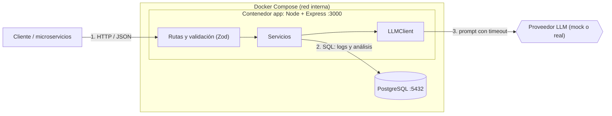

# Arquitectura

## Diagrama

## Flujo de datos

1. Los servicios envían logs con `POST /api/logs`. Se validan y se guardan en PostgreSQL.
2. `GET /api/logs` lista los logs con filtros (servicio, nivel, rango de fechas) y paginación.
3. `POST /api/logs/analyze` recibe una lista de ids de logs (máximo 200), verifica que existan, crea un análisis en estado `pending` y responde `202` con su id.
4. En segundo plano, el servicio llama al LLM con un timeout, valida la respuesta y guarda el resultado (`completed` o `failed`).
5. `GET /api/analysis/{id}` devuelve el estado y el resultado.

## Decisiones técnicas

| Decisión | Elegí | Descarté | Por qué |
|---|---|---|---|
| Framework | Express | Fastify | Lo conozco mejor; la ventaja de rendimiento de Fastify no justifica aprender otra herramienta en un prototipo. |
| Lenguaje | TypeScript | JavaScript | Tipos para modelar logs y respuestas del LLM, menos errores. |
| Base de datos | PostgreSQL | MongoDB, SQLite | Los logs tienen estructura fija y necesito consultas de agregación e índices; SQLite complica el despliegue con Docker. |
| Acceso a datos | `pg` con SQL | ORM (Prisma, TypeORM) | Control total de las agregaciones y menos dependencias. |
| Validación | Zod | Validación manual | Esquemas reutilizables que también dan los tipos de TypeScript. |
| Análisis | Asincrónico (202 + consulta por id) | Sincrónico | El LLM puede tardar o fallar; no conviene bloquear la petición. |
| LLM | Interfaz `LLMClient` con mock | Acoplarse a un proveedor | Permite testear sin costo y cambiar de proveedor sin tocar la lógica. |
| Migraciones | Scripts SQL versionados | Herramienta de migraciones | Simple y fácil de revisar. |
| Despliegue | Docker Compose (app + db) | Instalación manual | Se levanta con un solo comando. |

## Modelo de datos

| Decisión | Elegí | Descarté | Por qué |
|---|---|---|---|
| Validación del nivel | `CHECK` en la base, además de Zod | Validar solo en la app | La base rechaza niveles inválidos aunque alguien inserte sin pasar por la API. |
| Fechas del log | `logged_at` (cuándo ocurrió) y `created_at` (cuándo llegó) | Un solo timestamp | Pueden diferir por demoras de red, y las consultas por rango usan `logged_at`. |
| Datos extra del log | `metadata` en JSONB | Columnas fijas o tabla clave-valor | Cada microservicio manda datos distintos (request id, usuario) sin cambiar el esquema. |
| Resultado del LLM | `categories` y `suggestions` en JSONB dentro de `analyses` | Tablas normalizadas | Tienen estructura variable y no se consultan por separado; normalizar sería sobreingeniería en un prototipo. |
| Logs de un análisis | Tabla intermedia `analysis_logs` | Array de ids en `analyses` | Mantiene la integridad referencial y permite consultar en ambos sentidos. |
| Identificadores | `BIGSERIAL` en `logs`, UUID en `analyses` | Enteros o UUID en todas las tablas | Los logs son muchos y se insertan seguido; el id del análisis se expone en la API y no debe ser adivinable. |
| Estado del análisis | `status` con `pending`, `completed` y `failed` | Booleano de terminado | Soporta el análisis asincrónico y distingue una falla de un análisis en curso. |
| Índices | Compuestos `(service, logged_at)` y `(level, logged_at)` | Sin índices o uno por columna | Cubren los filtros de `GET /api/logs` y las agregaciones por rango de fechas. |  |     |
| Seed repetible | Bloque `DO` que inserta solo si `logs` está vacía | Seed sin guardia o `TRUNCATE` previo | Correrlo dos veces no duplica datos ni pisa logs reales. |

## API

| Decisión | Elegí | Descarté | Por qué |
|---|---|---|---|
| Estructura | Rutas, servicios y esquemas separados | Todo en los handlers | Las rutas solo validan y responden; el SQL se prueba por separado. |
| Validación | Zod en el borde de cada endpoint | Validar dentro de los servicios | Los datos inválidos se rechazan antes de tocar la base. |
| Errores | Un manejador central con formato único | `try/catch` en cada ruta | Respuestas consistentes y sin filtrar detalles internos en los `500`. |
| Códigos HTTP | `400` por datos inválidos, `404` si no existe, `422` si es válido pero no procesable (por ejemplo, más de 200 logs), `503` si la base no responde | Usar `400` para todo | Cada código dice qué falló. |
| Paginación | `limit` y `offset` con `total` | Paginación por cursor | Más simple para un prototipo; el cursor rinde mejor con millones de filas y queda como mejora. |
| Rango de fechas | `from` inclusivo y `to` exclusivo | Ambos inclusivos | Coincide con la consulta de agregación y evita contar dos veces el borde. |
| Id de los logs | Se devuelve como string | Número | `BIGSERIAL` puede superar el entero seguro de JavaScript. |

## Integración con IA

| Decisión | Elegí | Descarté | Por qué |
|---|---|---|---|
| Entrada del análisis | Lista de ids de logs | Filtros (servicio, fechas) | Es explícito y simple. Para analizar por filtro, el cliente primero lista los logs con `GET /api/logs`. |
| Respuesta del LLM | Se trata como `unknown` y se valida con Zod | Confiar en su formato | Un LLM puede devolver otra estructura; si no cumple, el análisis queda en `failed`. |
| Timeout | `Promise.race` con `LLM_TIMEOUT_MS` | Sin límite | Evita análisis colgados en `pending`. Limitación: no cancela la llamada al LLM, solo deja de esperarla. |
| Guardado | Transacción para el análisis y sus logs | Dos inserts sueltos | Todo o nada: no quedan análisis sin logs. |
| Errores del LLM | Se guarda un código corto en `error` y el detalle va a la consola | Guardar el mensaje original | No se filtran datos internos del proveedor en la API. |
| Mock | Categoriza por palabras clave y analiza los logs recibidos | Un texto fijo | La demo se ve creíble y los patrones del seed se detectan. |
| Construcción de la app | `createApp(llm)` | App global | Los tests inyectan un LLM falso (lento o con formato inválido). |

## Tests

| Decisión | Elegí | Descarté | Por qué |
|---|---|---|---|
| Base para los tests | Base `smartlog_test` en el mismo contenedor, recreada en cada corrida con la migración | Mockear la base o usar la de desarrollo | Prueba el SQL y la migración de verdad sin tocar los datos de desarrollo. |
| Tests de integración | Supertest sobre `createApp()`, sin abrir puertos | Levantar el servidor y usar `fetch` | Más rápido y sin conflictos de puertos. |
| LLM en los tests | Clientes falsos inyectados en `createApp(llm)` | Mockear módulos | Permite simular respuesta válida, formato inesperado, timeout y errores. |
| Aislamiento | Se vacían las tablas antes de cada test y los archivos corren de a uno | Tests en paralelo | Los archivos comparten una base y los tests no deben depender entre sí. |

## Supuestos

- Los logs se ingestan de a uno (`POST /api/logs`).
- Un análisis acepta hasta 200 logs, para acotar el tamaño del prompt. Si se envían más, la API responde `422`.
- Sin autenticación.
- Todos los errores usan un formato único: `{ "error": { "code": "VALIDATION_ERROR", "message": "...", "details": [...] } }`.
- `GET /api/logs` pagina con `limit` (50 por defecto, máximo 200) y `offset`.
- Los niveles válidos son `DEBUG`, `INFO`, `WARN` y `ERROR`.
- Para analizar logs por filtro (servicio o fechas), el cliente primero los lista con `GET /api/logs` y luego envía los ids a `analyze`.

## Despliegue

| Decisión | Elegí | Descarté | Por qué |
|---|---|---|---|
| Imagen de la app | Build en dos etapas (compilar y correr) | Una sola etapa | La imagen final no lleva TypeScript ni dependencias de desarrollo. |
| Usuario del contenedor | `node` (sin privilegios) | `root` | Si la app se compromete, tiene menos permisos. |
| Orden de arranque | `depends_on` con healthcheck de la base | Reintentos de conexión en el código | Es simple y la app no arranca antes de que la base esté lista. |
| Migraciones | Se montan en `/docker-entrypoint-initdb.d` | Un comando de migración aparte | Un solo `docker compose up`. Limitación: solo corren al crear la base; para aplicar cambios hay que recrear el volumen. |
| Configuración | Variables de entorno con valores por defecto en el compose | Exigir un `.env` | El proyecto levanta sin pasos extra y no hay secretos en el repo. |

### Puertos, red y variables

**Puertos**

| Servicio | Puerto en el contenedor | Puerto en tu máquina |
|---|---|---|
| app | 3000 | `PORT` (3000 por defecto) |
| db | 5432 | 5432 (para tests y desarrollo local) |

**Red:** Compose crea una red interna donde los servicios se encuentran por nombre. La app se conecta a la base con el host `db`.

**Variables de entorno**

| Variable | Qué hace | Por defecto |
|---|---|---|
| `PORT` | Puerto publicado de la API en tu máquina | `3000` |
| `DATABASE_URL` | Conexión a PostgreSQL. En Docker la fija el compose; en desarrollo local va en el `.env` | (sin valor) |
| `LLM_PROVIDER` | Cliente de IA: `mock` | `mock` |
| `LLM_TIMEOUT_MS` | Tiempo máximo de espera al LLM | `10000` |

## Limitaciones conocidas

- Si el servidor se reinicia mientras hay un análisis `pending`, queda en ese estado para siempre (no hay cola persistente ni reintentos).
- No hay tests del caso "base de datos caída" en `/api/health` ni de concurrencia entre análisis simultáneos.
- Las credenciales de PostgreSQL (`smartlog`/`smartlog`) son de desarrollo; en un entorno real irían en un gestor de secretos.