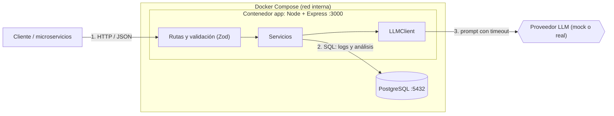

# Arquitectura

## Diagrama

## Flujo de datos

1. Los servicios envían logs con `POST /api/logs`. Se validan y se guardan en PostgreSQL.
2. `GET /api/logs` lista los logs con filtros (servicio, nivel, rango de fechas) y paginación.
3. `POST /api/logs/analyze` recibe un filtro o un conjunto de ids, crea un análisis en estado `pending` y responde `202` con su id.
4. En segundo plano, el servicio carga los logs, llama al LLM con un timeout, valida la respuesta y guarda el resultado (`completed` o `failed`).
5. `GET /api/analysis/{id}` devuelve el estado y el resultado.

## Decisiones técnicas

| Decisión       | Elegí                               | Descarté                   | Por qué                                                                                                                 |
| -------------- | ----------------------------------- | -------------------------- | ----------------------------------------------------------------------------------------------------------------------- |
| Framework      | Express                             | Fastify                    | Lo conozco mejor; la ventaja de rendimiento de Fastify no justifica aprender otra herramienta en un prototipo.          |
| Lenguaje       | TypeScript                          | JavaScript                 | Tipos para modelar logs y respuestas del LLM, menos errores.                                                            |
| Base de datos  | PostgreSQL                          | MongoDB, SQLite            | Los logs tienen estructura fija y necesito consultas de agregación e índices; SQLite complica el despliegue con Docker. |
| Acceso a datos | `pg` con SQL                        | ORM (Prisma, TypeORM)      | Control total de las agregaciones y menos dependencias.                                                                 |
| Validación     | Zod                                 | Validación manual          | Esquemas reutilizables que también dan los tipos de TypeScript.                                                         |
| Análisis       | Asincrónico (202 + consulta por id) | Sincrónico                 | El LLM puede tardar o fallar; no conviene bloquear la petición.                                                         |                        |
| LLM            | Interfaz `LLMClient` con mock       | Acoplarse a un proveedor   | Permite testear sin costo y cambiar de proveedor sin tocar la lógica.                                                   |
| Migraciones    | Scripts SQL versionados             | Herramienta de migraciones | Simple y fácil de revisar.                                                                                              |
| Despliegue     | Docker Compose (app + db)           | Instalación manual         | Se levanta con un solo comando.                                                                                         |

## Supuestos

- Los logs llegan de a uno (`POST /api/logs`); el tamaño máximo de un análisis es de N logs para acotar el prompt.
- No hay autenticación (es una herramienta interna de prototipo).

## Limitaciones conocidas

